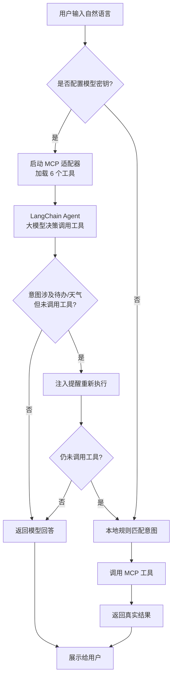

# 个人事务智能助手 3.0-Astra

基于 **MCP（Model Context Protocol）+ LangChain Agent** 的个人事务智能助手。用户可以用自然语言管理待办事项、查询城市天气、导出待办清单，支持**命令行**和**网页**两种交互方式。配置大模型密钥后由大模型理解意图并调用工具；没有密钥时自动降级为本地规则匹配，核心功能依然可用。

---

## 一、需求描述

### 功能性需求

1. **待办管理**
   - 添加待办：支持自然语言添加，自动解析截止日期（支持 `YYYY-MM-DD` 显式日期和「今天 / 明天 / 后天 / 大后天」相对日期）
   - 查看待办：支持按状态筛选（未完成 / 已完成 / 全部）
   - 标记完成：按 ID 将待办标记为已完成
   - 删除待办：按 ID 删除待办
2. **天气查询**：输入城市名称，返回当前天气、温度、体感温度、湿度、风速
3. **清单导出**：将所有待办一键导出为 Markdown 文件
4. **双端交互**：提供命令行（CLI）和网页（Gradio）两种使用方式
5. **多模型支持**：按优先级自动选择火山方舟（豆包）/ DeepSeek / 百炼（通义千问）；未配置任何密钥时降级为本地规则匹配，保证核心功能可用
6. **多轮对话**：支持带上下文的连续对话

### 非功能性需求

- **数据持久化**：待办数据存入本地 SQLite 数据库，重启不丢失
- **可靠性**：防止模型幻觉编造数据——涉及待办/天气的请求必须通过工具获取真实结果
- **安全性**：导出文件路径限制在项目目录内，拒绝绝对路径与目录穿越
- **易用性**：Windows 一键启动脚本，首次运行自动创建虚拟环境并安装依赖

---

## 二、业务流描述

1. 用户在 CLI 或网页端输入自然语言指令；
2. 系统按优先级检查模型密钥配置：**火山方舟 → DeepSeek → 百炼**；
3. **已配置密钥**：
   - 通过 MCP 适配器启动 MCP 工具服务，加载 6 个工具；
   - LangChain Agent 携带对话历史和系统提示词，由大模型决策调用哪个工具；
   - 若用户意图涉及待办/天气但模型未调用工具（存在幻觉风险），系统自动注入「请调用工具」的提醒，要求模型重新执行；
   - 重试后仍未调用工具，则回退到本地规则处理，保证结果来自真实数据；
4. **未配置密钥**：直接由本地规则匹配用户意图，并调用对应的 MCP 工具；
5. 工具执行：待办类工具读写 SQLite 数据库，天气查询调用 wttr.in 公开 API，导出工具在项目目录下生成 Markdown 文件；
6. 将结果以自然语言返回给用户，并更新对话历史。



---

## 三、实现说明

### 总体架构

项目采用分层架构：交互层 → 智能体层 → 工具层 → 数据层。

```
┌──────────────────────────────────────────┐
│ 交互层    agent_main.py（命令行入口）      │
│          app.py（Gradio 网页入口）         │
├──────────────────────────────────────────┤
│ 智能体层  assistant.py                    │
│          LangChain Agent + LLM            │
│          本地规则回退（local_answer）      │
├──────────────────────────────────────────┤
│ 工具层    mcp_server.py（FastMCP 服务）    │
│          6 个 MCP 工具                    │
├──────────────────────────────────────────┤
│ 数据层    SQLite（todos.db）              │
│          wttr.in 天气 API                 │
└──────────────────────────────────────────┘
```

### 模块说明

| 文件 | 职责 |
| --- | --- |
| `mcp_server.py` | 基于 FastMCP 的 MCP 工具服务，注册 `add_todo`、`list_todos`、`complete_todo`、`delete_todo`、`get_weather`、`export_todos` 六个工具，封装 SQLite 增删改查、天气请求与 Markdown 导出 |
| `assistant.py` | 核心对话逻辑：构建 LLM 与 LangChain Agent，通过 `MCPAdapter` 接入 MCP 工具；实现防幻觉校验与本地规则回退（`local_answer`），命令行与网页共用 |
| `agent_main.py` | 命令行入口，异步聊天循环，输入 `quit` 退出 |
| `app.py` | Gradio 网页入口，通过后台事件循环桥接异步 Agent 调用，维护多轮对话记忆（最多保留 40 条） |
| `settings.py` | 模型配置加载，按火山方舟 → DeepSeek → 百炼的优先级读取 `.env` |
| `start_cli.bat` / `start_web.bat` | Windows 一键启动脚本，自动创建虚拟环境并安装依赖 |
| `tests/` | pytest 测试套件，覆盖待办全生命周期、路径安全、防幻觉回退等场景 |

### 技术选型

| 技术 | 用途 |
| --- | --- |
| Python 3.10+ | 开发语言 |
| FastMCP | 构建 MCP 工具服务 |
| LangChain + langchain-openai | Agent 框架，通过 `MCPAdapter` 接入 MCP 工具 |
| Gradio | 网页聊天界面（`ChatInterface`） |
| SQLite | 本地数据持久化，零配置 |
| wttr.in | 免费天气查询 API |
| pytest | 单元测试 |

### 关键设计

1. **MCP 工具化**：将待办/天气能力封装为 6 个标准 MCP 工具，模型与工具解耦——工具服务可被任何支持 MCP 的客户端复用，Agent 只需按协议调用；
2. **防幻觉机制**：系统提示词明确要求「所有待办、天气信息必须调用工具获取，禁止凭空编造」；若检测到意图涉及待办/天气但模型未调用工具，自动注入提醒重试一次；仍失败则回退本地规则处理，确保返回结果来自真实数据（有专门测试覆盖）；
3. **多模型降级链**：按火山方舟（豆包）→ DeepSeek → 百炼（千问）顺序读取密钥，任一可用即可运行；全部缺失时降级为本地规则匹配，核心功能不受影响；
4. **日期解析**：本地规则支持 `YYYY-MM-DD` 显式日期与「今天/明天/后天/大后天」相对日期，自动换算后存入数据库；
5. **导出路径安全**：导出文件仅允许写入项目目录，拒绝绝对路径和目录穿越（如 `../../etc/passwd`），并有对应测试覆盖；
6. **网页异步桥接**：Gradio 回调是同步的，通过后台事件循环 + `asyncio.run_coroutine_threadsafe` 调用异步 Agent，并设置 180 秒超时。

---

## 四、使用示例（功能演示）

### 环境要求

- Python 3.10 或更高版本

### 安装与启动

**Windows**：

1. 解压整个文件夹（不要只抽出单个 py 文件）；
2. 网页版：双击 `start_web.bat`，浏览器打开 <http://127.0.0.1:7860>；
3. 命令行版：双击 `start_cli.bat`。

首次运行会自动创建虚拟环境并安装依赖。

**macOS / Linux**：

```bash
python3 -m venv .venv
source .venv/bin/activate
pip install -r requirements.txt
python app.py          # 网页版
# 或
python agent_main.py   # 命令行版
```

### 配置模型密钥（可选）

将 `.env.example` 复制为 `.env`，三套密钥配置一套即可（优先级：火山方舟 > DeepSeek > 百炼）：

```env
DEEPSEEK_API_KEY=你的密钥
```

不配置密钥也可以使用：系统自动降级为本地规则匹配，固定句式同样可以管理待办和查天气。

### 功能演示

**命令行对话示例**：

```
个人事务智能助手已就绪（DeepSeek · deepseek-chat）
输入 quit 退出。

你: 帮我加一条待办：后天交数据库作业
助手: 已添加待办 [1]：交数据库作业（截止：2026-10-23）

你: 帮我加一条待办：2026-10-26 复习操作系统第五章
助手: 已添加待办 [2]：复习操作系统第五章（截止：2026-10-26）

你: 看看我有哪些待办
助手: ⬜ [1] 交数据库作业  |  截止: 2026-10-23
      ⬜ [2] 复习操作系统第五章  |  截止: 2026-10-26

你: 把 1 标记为完成
助手: 待办 [1] 已标记为完成 ✅

你: 看看已完成的待办
助手: ✅ [1] 交数据库作业  |  截止: 2026-10-23

你: 北京今天天气怎么样
助手: 📍 北京 当前天气：晴，温度 18°C，体感 17°C，湿度 40%，风速 12 km/h

你: 把待办导出成文件
助手: 已导出 2 条待办到 todos_export.md

你: quit
再见。
```

**网页版**：Gradio 聊天界面（标题「个人事务智能助手 3.0-Astra」），自带示例问题，点击即可体验；对话历史在页面刷新前保持连续。

**导出文件内容示例**（`todos_export.md`）：

```markdown
# 📋 待办清单

> 导出时间：2026-10-21 15:30

- [x] 交数据库作业  (截止: 2026-10-23)
- [ ] 复习操作系统第五章  (截止: 2026-10-26)
```

### 运行测试

```bash
python -m pytest -q
```

测试套件覆盖：待办全生命周期（增/查/完成/删）、导出路径安全、天气查询、MCP 六工具注册、显式日期解析、防幻觉回退等场景。

---

## 五、GitHub 链接

https://github.com/flanklinyang/assistant

---

## 六、小组分工

| 成员             | 分工 |
|----------------| --- |
| 杨富林 3124004072 | MCP 工具服务（`mcp_server.py`）、天气查询、导出与路径安全、测试编写 |
| 黎正阳 3124004060 | Agent 核心逻辑（`assistant.py`）、多模型配置（`settings.py`）、CLI 与网页入口、README 文档 |


---

## 七、每个小组成员的心得

### 杨富林 3124004072

这次项目我负责 MCP 工具服务、天气查询、导出功能和测试编写。刚开始我对 MCP 协议一无所知，通过阅读 FastMCP 文档，把待办增删改查、天气查询和导出封装成了六个标准工具，最大的收获是理解了「工具化」的价值：工具与模型解耦后，同一套工具既能被 Agent 调用，也能被本地规则直接使用。印象最深的是导出功能的路径安全问题——测试时发现用户输入 `../../` 就能把文件写到项目目录之外，于是改为校验解析后的路径必须位于项目目录内，并补上了对应测试。这让我意识到，写代码不仅要考虑「怎么跑通」，更要考虑「可能被怎么误用」。此外，用 pytest 为待办全生命周期和防幻觉回退编写测试的过程，也让我养成了先想清边界条件再动手的习惯。


### 黎正阳 3124004060

我负责 Agent 核心逻辑、多模型配置、命令行与网页入口，以及 README 文档。遇到的最大难题是大模型的「幻觉」：有时它不调用工具，直接编造待办和天气数据。经过反复调试，最终采用「提示词约束 → 检测到未调用工具时注入提醒重试 → 仍失败则回退本地规则」的三层防幻觉机制，并用测试验证了整条链路，这让我对「模型输出不可完全信任」有了切身体会。多模型降级链的设计让我学会了如何用同一套 OpenAI 兼容接口适配火山方舟、DeepSeek、百炼三家平台。网页版开发时还踩过一个坑：Gradio 回调是同步的而 Agent 是异步的，最后用后台事件循环配合 `run_coroutine_threadsafe` 桥接解决，加深了我对 asyncio 事件循环的理解。撰写 README 的经历也让我明白，一份清晰的使用说明能让用户少走很多弯路。


